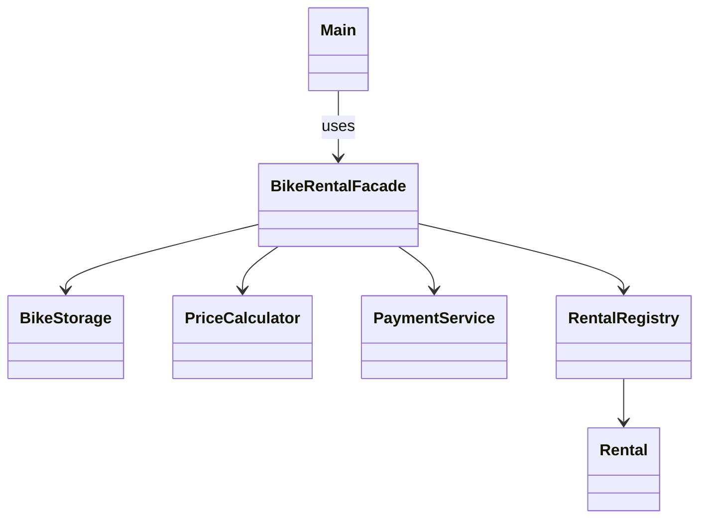

# Bicycle rental with Facade

Assignment 4 for Software Design Patterns.

This is a small Java program for renting bicycles. A student chooses a bike type and a number of hours. The program finds a free bike, calculates the price, charges the student's balance and saves the rental.

`Main` only uses `BikeRentalFacade`. It does not need to know which classes store bikes, take payments or keep rental records.

## Run

The project needs a JDK, version 8 or newer. There are no external libraries. Run these commands from the project folder. Use `javac` and `java` from the same JDK.

```text
mkdir out
javac -encoding UTF-8 -d out src/*.java
java -cp out Main
```

You can also open the folder in a Java IDE, select a JDK, mark `src` as the source folder and run `Main`.

## Demo data

| Item | Value |
| --- | --- |
| Student s1 | 5000 KZT |
| Student s2 | 300 KZT |
| City bikes | 101 and 102 |
| Mountain bike | 201 |
| City price | 500 KZT per hour |
| Mountain price | 800 KZT per hour |
| Rental duration | 1 to 24 whole hours |

Bike types are written as `city` and `mountain`. These prices and balances are just demo values.

The demo rents a city bike for two hours. The balance of s1 becomes 4000 KZT. Then it shows a failed payment by s2 and another successful rental by s1. Trying to rent a third city bike fails because both are occupied. Finally, the first bike is returned. The final balance of s1 is 3500 KZT.

## Classes

| Class | Responsibility |
| --- | --- |
| `BikeStorage` | Finds a free bike of the requested type, reserves it and releases it after return |
| `PriceCalculator` | Checks the bike type and rental duration, then calculates the price |
| `PaymentService` | Stores balances, rejects payments without enough money and supports refunds |
| `RentalRegistry` | Generates rental IDs, stores records and finishes rentals |
| `Rental` | Holds the data and active or returned state of one rental |
| `BikeRentalFacade` | Coordinates the four subsystem classes |
| `Main` | Demonstrates the program through the facade |



## Why this is Facade

The client makes one call:

```java
int rentalId = rentalService.rentBike("s1", "city", 2);
```

Inside this call, the facade checks the account, calculates the price, reserves a bike, charges the account and creates a rental record. The bike ID from storage and the calculated price are passed to the registry. Without the facade, the client would have to coordinate these steps and handle partial failure itself.

If payment fails after reservation, the facade releases the bike. If a runtime exception occurs while creating the record after a successful payment, it refunds the payment and releases the bike. These steps keep an unsuccessful rental from holding a bike or taking money in this single-threaded demo.

The facade also provides `returnBike`, `getRentalInfo` and `getBalance`. Its public methods use IDs, strings and numbers, so the client does not receive subsystem objects.

The subsystem classes have no reference to `BikeRentalFacade`. They are public and can be used directly by an advanced client. For example, `PriceCalculator` can calculate a price on its own. The facade is a convenient entry point, not a restriction on accessing other classes.

## Clean Code principles

1. **Meaningful names.** Names such as `rentBike`, `calculatePrice` and `getBalance` explain what the methods do.
2. **Single responsibility.** Storage manages availability, the calculator handles prices, payments manage balances and the registry keeps rental records. The facade coordinates their work.
3. **Encapsulation.** The maps, sets and balances are private. The client cannot change them through the facade.
4. **Small methods.** Reserving a bike, charging money and finishing a rental are separate operations. Each method is short enough to follow without switching between unrelated tasks.
5. **Early validation.** Unknown students, unsupported bike types and invalid durations are rejected before the facade reserves a bike or charges money.
6. **Clear error handling.** Invalid input causes `IllegalArgumentException`. A valid request that cannot be completed, such as an unpaid rental or a repeated return, causes `IllegalStateException`. The facade undoes a reservation when payment fails.
7. **Named constants.** Hourly rates and the maximum duration are declared in `PriceCalculator`, so changing a price does not require editing the facade or the client.

## Tests

After creating the `out` folder, run:

```text
javac -encoding UTF-8 -d out src/*.java test/*.java
java -cp out BikeRentalTest
```

Expected result: `All 7 tests passed.` The tests cover prices, failed-payment rollback, occupied bikes, returns, repeated returns, invalid requests and unknown rental IDs. The code was also compiled for Java 8 and run on a Java 8 runtime.

## Scope

Data is kept in memory and resets when the program restarts. The program runs in one thread. A rental is prepaid for the selected duration; there is no clock, late fee or refund for returning early. Money is stored as whole tenge. This is a demonstration of Facade, not a complete rental application.
